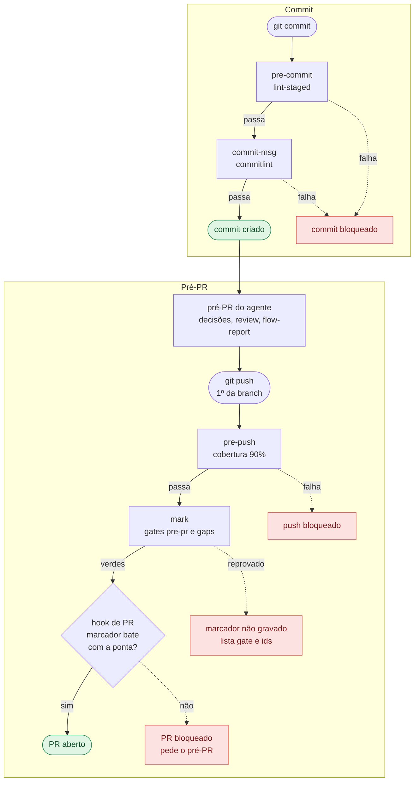

# Feedback loops do commit e do pré-PR

Onde o erro é pego antes de chegar ao CI. Dois pontos: o **commit** (rápido, a cada commit) e o **pré-PR** (pesado, uma vez por branch, mais o freio que o agente cumpre antes de abrir o PR). O que o CI repete depois está em [qualidade-e-testes.md](directives/qualidade-e-testes.md).

## Mapa rápido



Linha pontilhada = bloqueio: corrija e repita o passo. A tabela abaixo detalha cada ponto.

| Ponto | Gatilho | O que roda | Bloqueia quando | Tempo |
| --- | --- | --- | --- | --- |
| `pre-commit` | `git commit` | `eslint --fix`, `prettier --write`, `typecheck` e specs (`.ts`); `markdownlint`, `cspell` e dois specs de doc (`.md`) | lint sem correção automática, erro de tipo, spec vermelho, `.md` fora da regra | ~5 s de núcleo, mais o spec espelho |
| `commit-msg` | `git commit` | `commitlint` na mensagem | fora do Conventional Commits, header acima de 80 caracteres, corpo preenchido | instantâneo |
| `pre-push` | 1º push de uma branch | `npm run test:coverage` | spec vermelho (inclusive os de bundle, que constroem o artefato), cobertura abaixo de 90% | 3 a 5 min |
| Pré-PR do agente | "faz o pré-PR" (skill `flow-run`) | texto das decisões, review, `flow-report`, `mark` | `finding` URGENT sem `decision`, `gap` sem fechador | minutos, depende da review |
| Hook de PR | abrir o PR (MCP ou `gh`) | confere o marcador do `mark` | sem marcador válido para a ponta da branch | instantâneo |

## Commit

Roda em todo `git commit`. Se qualquer etapa falhar, o commit não é criado.

1. **`pre-commit`** (`lint-staged --concurrent false`, só nos arquivos em stage; com `.ts` e `.md` juntos, uma chave termina antes de a outra começar)
   - Com `.ts` em stage:
     1. `eslint --fix`
     2. `prettier --write`
     3. `typecheck` do projeto inteiro
     4. Specs: o núcleo fixo (~5 s) e o spec de mesmo nome de cada arquivo
   - Com `.md` em stage:
     1. `markdownlint`
     2. `cspell` (pt-BR)
     3. `directives.spec` e `skill-coherence.spec`
2. **`commit-msg`** (`commitlint`)
   - Conventional Commits
   - Header de até 80 caracteres
   - Sem corpo
   - `Merge`, `Revert` e commits do Dependabot passam direto

### Fora do alcance do commit

- ESLint e Prettier rodam só em `.ts`: `.json`, `.yml` e `.js` só são conferidos no CI (`format:check`, e ESLint em `.js`).
- `.claude/settings.json` não é conferido por nenhum dos dois.
- Regressão de teste em quem importa o arquivo editado só aparece no `pre-push` e no CI; erro de tipo aparece no commit.
- `--no-verify` e `HUSKY=0` pulam todos os hooks.
- Worktree nova sem `npm ci` fica sem hooks.

## Pré-PR

Da última decisão até o PR aberto, nesta ordem:

1. **Roteiro do agente** (`flow-run`): confere as decisões registradas, não roda comando de qualidade
   1. Comparar o texto de cada `decision` com o diff
      - Divergiu: regrava a decisão
   2. Rodar a review
      - Cada achado vira `finding`
      - Todo URGENT é corrigido
   3. Rodar o `flow-report`
      - Só aponta decisões com base fraca; nunca bloqueia
   4. Fazer o `git push`
      - No **1º push da branch** o `pre-push` roda `test:coverage` (piso de 90%), de 3 a 5 min
      - Falhou: o push é bloqueado
   5. Rodar o `mark`
      - Confere dois gates
        - `pre-pr`: todo URGENT tem uma `decision` que o resolve
        - `gaps`: toda lacuna tem fechador
      - Verdes: grava o marcador (branch e sha do `HEAD`)
      - Reprovado: não grava e lista gate e ids
2. **Hook de PR** (ao abrir o PR)
   - Passa:
     - PR com marcador válido (branch e sha batem com a branch atual e, se `origin/<branch>` existe localmente, com ela)
     - PR em rascunho
     - `gh pr ready` na branch atual, com marcador válido
   - Negado:
     - PR sem marcador
     - `gh pr ready` sem marcador, com número, URL ou `-R`
     - `update_pull_request` com `draft: false`
     - Entrada ilegível, falha do `git` ou `node` ausente

### Atenção

- Correção que muda arquivo versionado muda o `HEAD`: volte à comparação do texto das decisões (passo 1) e siga ao `flow-report`; a review não roda de novo.
- Commit depois do `mark` invalida o marcador: rode o `mark` de novo.
- Lacuna que contradiz premissa atemporal abre o PR em rascunho, sem `mark`; a skill `flow-gaps` fecha depois.
- O hook é freio contra descuido: forjar o marcador é possível, e `gh api` não é coberto.

## Quem pega o quê

| Erro | Quem avisa | Quando |
| --- | --- | --- |
| Lint ou formatação | `pre-commit` | No commit |
| Erro de tipo | `pre-commit` | No commit |
| Regressão no domínio, na cadeia ou no `register` | `pre-commit` (núcleo) | No commit |
| Regressão em arquivo com spec de mesmo nome | `pre-commit` (espelho) | No commit |
| `.md` com ortografia, link ou lint quebrado | `pre-commit` | No commit |
| Mensagem de commit fora do padrão | `commit-msg` | No commit |
| Regressão em quem importa o arquivo, e specs de bundle | `pre-push` | 1º push |
| Cobertura abaixo de 90% | `pre-push` | 1º push |
| Decisão com texto diferente do diff | passo 1 do pré-PR | Antes do PR |
| URGENT sem decisão, lacuna sem fechador | `mark` | Antes do PR |
| PR aberto sem passar pelo pré-PR | hook de PR | Ao abrir |
| Tudo o que escapou, mais audit, knip, orçamento de tempo, linha do changelog | CI | No PR |

## Rodar na mão

```sh
npm run typecheck && npm run lint && npm run knip && npm run format:check
npm run lint:md && npm run spell
npm run test:coverage            # o mesmo do pre-push
npx jest test/domain test/shared # o núcleo do pre-commit
node scripts/flow/gate.ts pre-pr <slug>   # os gates, sem gravar o marcador
node scripts/flow/report.ts <slug>        # o relatório de decisões
```

### Sonda das ações do critic

Roteiro manual, fora do CI, que gasta Opus e a cota do `agy`: só com pedido explícito do dono. O critic tem de ser recém-lançado a partir do checkout final (as regras congelam no `start`): um critic vivo de antes é substituído sem contar nas 2 substituições do `flow-run`. Cada sonda grava `<slug>.premise.sonda-<n>` e `<slug>.evidence.sonda-<n>` no processo do trabalho, com `actionUsed` fixado, e as revoga ao fim. A degradação forçada vai como linha `Unavailable: <ações>` no cabeçalho da mensagem da pergunta, antes e fora do bloco de contexto, nunca dentro de `gap.context`. O esperado sai da tabela de [cadeira-do-dono.md](directives/cadeira-do-dono.md) com os literais que o principal escreveu; o roteiro assere sobre a resposta e o `attach` (`Action: <usada>`), e o `actionUsed` lido do log é só observação.

| Caso | Transporte | Classe | Natureza | Mensagem traz | Esperado |
|---|---|---|---|---|---|
| a1 | `claude-herdr` | comum | `repo-fact` (leitura de código fora de docs e hexlog) | | `local` e `actionUsed=local`; prova o canal da frase de uma linha e que o `Read` do critic alcança `critic-rules.txt` fora do `cwd` |
| a2 | `claude-herdr` | comum | `external-fact` | | `web`, ou o registro de que `document-specialist` não alcança a web nesse transporte |
| a3 | `claude-herdr` | comum | `choice` (a evidência local não decide) | | `jury` |
| a4 | `claude-runner` | crítica | `external-fact` | | `jury`, premissa sem `fills-gap` |
| b | `claude-runner` | comum | `choice` | `Unavailable: jury` | `web` e `actionUsed=web` |
| b2 | `agy` no Herdr | crítica | `choice` | | `actionUsed` em `web` ou `local`, nunca `jury`; o aval mostra a marca; confirma se o `agy` tem busca web |
| c | `claude-runner` | comum | `choice` | `Unavailable: jury, web, local` | `sem resposta`, motivo no `attach`, nenhuma premissa `simulated` |
| d (opcional) | qualquer | comum | `choice` | `Unavailable: jury` | só em processo sem `actionUsed` fixado: `sem resposta` |

O `agy` no runner usa o mesmo código e a mesma coluna que no Herdr; o canal do Herdr é o que b2 prova. Se a sonda mostrar que o `agy` não tem busca web ou que o Herdr não alcança a web, a célula da tabela do doc muda no mesmo commit.

Regras completas e o que o CI repete: [qualidade-e-testes.md](directives/qualidade-e-testes.md), [instalacao-e-hooks.md](directives/instalacao-e-hooks.md) e [fluxo-hexlog.md](directives/fluxo-hexlog.md).
